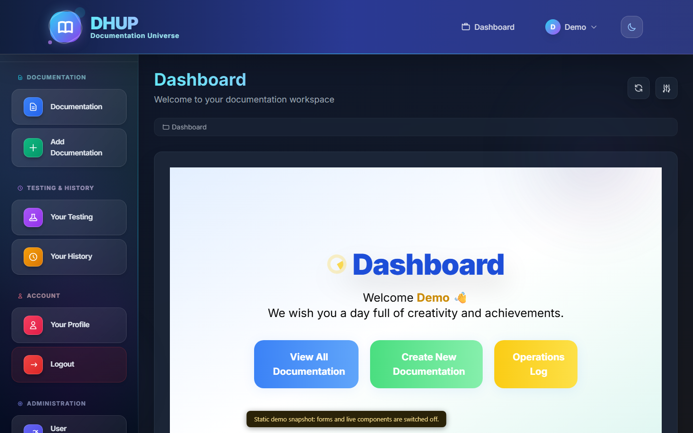

<div align="center">

# DOC · AI Documentation Platform

<sub>In the app it is called **DHUP, the Documentation Universe**.</sub>

**Create, organize, test and track software documentation in one place.**

[](https://faisalalghates.github.io/DOC/)


**[Live demo](https://faisalalghates.github.io/DOC/)** · [Features](#features) · [Run it](#run-it) · [Documentation](#documentation)



</div>

> **About the demo.** The live demo is a read-only static snapshot of the running app (a CI job boots Laravel on MySQL, signs in as a demo user and saves the pages). Forms and live components do not work in it. Run the project locally for the real thing.

## What it does

DOC keeps a team's software documentation, its tests and the history of every change in one web application, with AI assistance for writing and reviewing.

## Features

| Area | What you get |
| --- | --- |
| **Documentation** | Create, edit and organize documents: software engineering docs and best-practice docs |
| **Testing** | Plan and record tests next to the documentation they verify |
| **History** | Every change to a document is recorded and can be reviewed |
| **Users and roles** | Registration, login, user management with `admin` and `user` roles, profile and password management |
| **AI assistance** | OpenAI-backed helpers for documentation tasks (needs your own API key) |
| **Dashboard** | One place to see what exists and what changed |

## Tech stack

- **Backend:** PHP 8.2+, Laravel 12, Livewire 3 with Volt, Laravel Socialite
- **Frontend:** Blade, Tailwind CSS, Vite
- **Data:** MySQL or SQLite
- **AI:** OpenAI API
- **Quality:** Pest, Laravel Pint

## Run it

You need PHP 8.2+, Composer, Node.js and a database.

```bash
git clone https://github.com/FaisalAlghates/DOC.git
cd DOC

composer install
npm install

cp .env.example .env
php artisan key:generate    # if APP_KEY is missing from .env, add a line "APP_KEY=" first
# set DB_* in .env (MySQL) or use SQLite: touch database/database.sqlite
# optional, for the AI features: OPENAI_API_KEY=...

php artisan migrate
```

Then, in two terminals:

```bash
php artisan serve
npm run dev
```

Open <http://127.0.0.1:8000>, create an account and sign in. Run the tests with `php artisan test`.

## Documentation

[`SOFTWARE_DOCUMENTATION.md`](SOFTWARE_DOCUMENTATION.md) describes the system in detail: purpose, technical architecture, database schema, modules, controllers and interface design.

## License

MIT.
